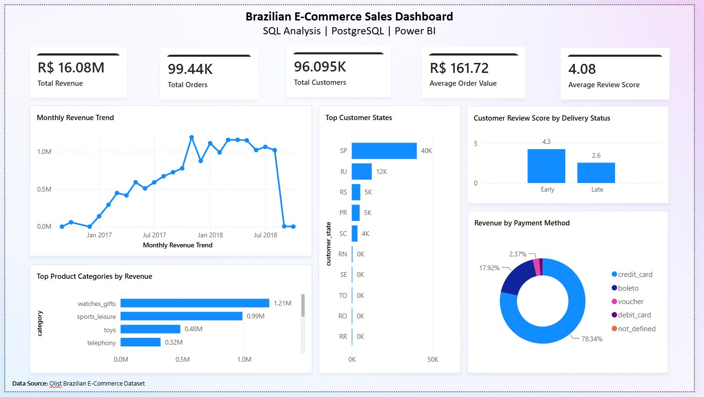

# Brazilian E-Commerce Sales Analysis | SQL & Power BI

## Project Overview

This project analyzes the Brazilian E-Commerce Public Dataset by Olist to explore sales performance, customer behavior, product categories, payment methods, and delivery performance.

Using **PostgreSQL** for data preparation and SQL analysis and **Power BI** for data visualization, this project transforms raw e-commerce data into business insights that can support data-driven decision-making.

## Dashboard Preview



## Project Objectives

The main objectives of this project are to:

- Analyze overall e-commerce sales performance.
- Identify top-performing product categories.
- Examine monthly revenue trends.
- Understand customer distribution across Brazilian states.
- Analyze payment methods and customer purchasing behavior.
- Explore the relationship between delivery performance and customer review scores.
- Present key findings through an interactive business intelligence dashboard.

## Tools and Technologies

- **PostgreSQL** — Database management and SQL analysis
- **SQL** — Data querying, aggregation, joining, and analysis
- **Microsoft Power BI** — Dashboard development and data visualization
- **Microsoft Excel / CSV** — Data inspection and intermediate data handling
- **GitHub** — Project documentation and version control

## Dataset

**Source:** [Brazilian E-Commerce Public Dataset by Olist — Kaggle](https://www.kaggle.com/datasets/olistbr/brazilian-ecommerce)

The dataset contains information about orders, customers, products, sellers, payments, reviews, and deliveries from a Brazilian e-commerce marketplace.

The original dataset includes multiple related CSV files that were imported into PostgreSQL for analysis.

*Note: The dataset represents historical transactions and does not reflect current e-commerce activity.*

## Project Workflow

### 1. Database Setup

- Imported the relevant CSV datasets into PostgreSQL.
- Organized the data into relational tables.
- Prepared the database for querying and analysis.

### 2. Data Preparation

- Reviewed the structure and contents of the tables.
- Examined missing values and data consistency where relevant.
- Used SQL joins to combine information from related tables for analysis.

### 3. SQL Analysis

Created SQL queries to investigate sales, customers, products, payments, and delivery performance.

Key analysis areas included:

- Sales and revenue performance
- Monthly revenue trends
- Product category performance
- Customer distribution by state and city
- Customer purchasing behavior
- Payment method distribution
- Delivery performance and customer reviews

### 4. Dashboard Development

- Exported summarized query results from PostgreSQL into CSV files.
- Imported the summary files into Power BI.
- Designed a dashboard to present key performance indicators and business trends.

## SQL Skills Demonstrated

This project demonstrates the use of:

- `SELECT`, `WHERE`, `GROUP BY`, and `ORDER BY`
- Aggregate functions such as `SUM()`, `COUNT()`, and `AVG()`
- `JOIN` operations across related tables
- Date-based analysis using `DATE_TRUNC()`
- Conditional logic using `CASE`
- Handling missing values with `COALESCE()`
- Distinct counts using `COUNT(DISTINCT ...)`
- Business-focused data aggregation and reporting

## Power BI Dashboard

The dashboard presents an executive overview of e-commerce performance through key metrics and visualizations.

### Key Performance Indicators

- Total Revenue / Payment Value
- Total Orders
- Total Customers
- Average Order Value
- Average Review Score

### Visualizations

- Monthly Revenue Trend
- Top Product Categories
- Payment Method Distribution
- Customers by State
- Delivery Performance and Review Scores

The dashboard was designed to provide a clear overview of business performance and make important trends easier to identify.

## Key Insights

The analysis and dashboard highlight several areas of interest:

- **Sales Performance:** The analyzed dataset contains approximately 99,000 orders and payment values totaling around R$16 million.
- **Customer Base:** The dataset represents more than 96,000 unique customers.
- **Geographic Distribution:** Customer activity is concentrated in certain Brazilian states, particularly São Paulo.
- **Payment Methods:** Credit cards represent a major share of recorded payment activity.
- **Customer Experience:** Comparing delivery performance with review scores helps explore how the delivery experience may relate to customer satisfaction.

*Note: Exact figures and findings should be interpreted according to the SQL queries and exported summary data used in the dashboard. Payment value should not be interpreted as profit.*

## Business Recommendations

Based on the analysis, e-commerce businesses could consider the following actions:

1. **Improve Delivery Performance:** Monitor delivery delays and investigate operational issues that may negatively affect customer experience.
2. **Focus on High-Performing Categories:** Evaluate top-performing product categories when planning inventory and marketing campaigns.
3. **Strengthen Regional Strategies:** Use customer distribution data to guide regional marketing and logistics decisions.
4. **Monitor Sales Trends:** Track monthly performance to identify changes in demand and support business planning.
5. **Maintain Customer Satisfaction:** Continue monitoring review scores and investigate recurring customer complaints.

These recommendations are potential actions suggested by the analysis, rather than measured outcomes of implemented business changes.

## Repository Structure

```text
retail-sales-sql-analysis/
├── dashboard/
│   ├── data/
│   │   ├── kpi_summary.csv
│   │   ├── revenue_by_month.csv
│   │   ├── monthly_performance.csv
│   │   ├── top_categories.csv
│   │   ├── payment_methods.csv
│   │   ├── customer_states.csv
│   │   └── delivery_reviews.csv
│   └── Brazilian E-Commerce Sales Dashboard.pbix
├── dataset/
│   └── dataset_source.txt
├── insights/
│   └── business_insights.md
├── queries/
│   ├── 01_database_setup.sql
│   ├── 02_data_cleaning.sql
│   ├── 03_sales_analysis.sql
│   ├── 04_customer_analysis.sql
│   ├── 05_executive_insights.sql
│   └── 06_dashboard_queries.sql
├── screenshots/
│   └── customers-count.png
│   ├── dashboard.png
│   ├── order-items-count.png
│   ├── orders-count.png
│   ├── products-count.png
└── README.md
```

*The structure above is illustrative. Update the filenames and folders to match the files actually included in your repository.*

## How to Reproduce This Project

1. Download the dataset from the [Kaggle dataset page](https://www.kaggle.com/datasets/olistbr/brazilian-ecommerce).
2. Set up a PostgreSQL database.
3. Import the required CSV files into PostgreSQL.
4. Run the SQL scripts in the appropriate order, adjusting table names or paths if needed.
5. Export the query results used for the dashboard as CSV files.
6. Import the exported CSV files into Power BI.
7. Recreate or explore the dashboard using the provided Power BI file, if included.

## Limitations

- The analysis is based on historical e-commerce data and may not represent current market conditions.
- The dashboard uses pre-aggregated CSV outputs exported from PostgreSQL rather than a live database connection.
- Because the dashboard uses separate summary datasets, cross-filtering between all visualizations may be limited.
- Payment value is not equivalent to net revenue or profit because costs, fees, refunds, and other financial factors may not be fully accounted for.
- Observed relationships between delivery performance and review scores do not, by themselves, establish causation.

## Author

**Data Analytics Portfolio Project**

GitHub: [g4-misscommit](https://github.com/g4-misscommit)

